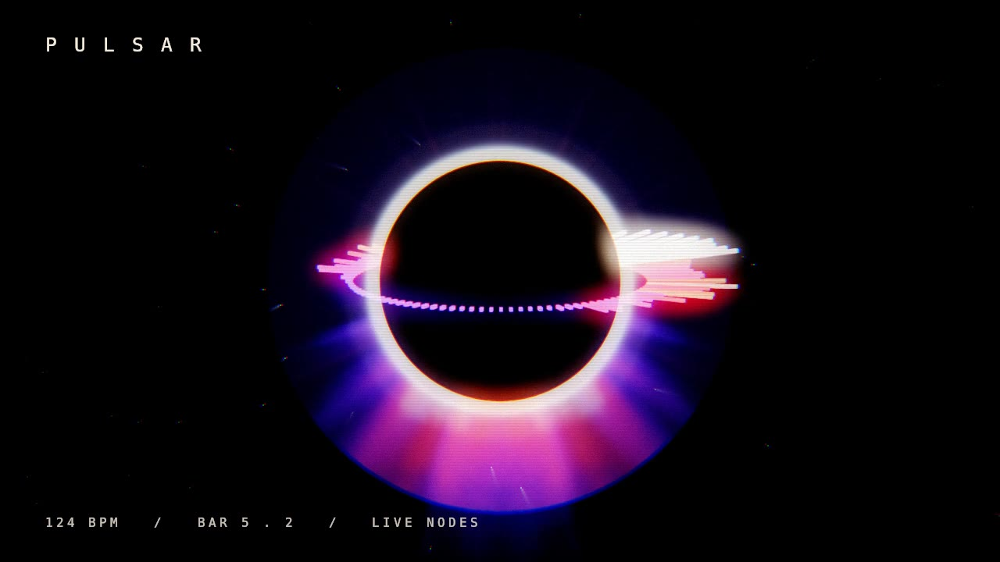

# Live Nodes — real-time / interactive visuals in Blender

Addon per Blender (4.2+, testato su **Blender 5.3**) che aggiunge un editor a nodi
"live" ispirato al modello di TouchDesigner: una rete di operatori che viene
*cucinata* (cooked) continuamente a frame rate fisso, indipendentemente dalla
timeline, e che pilota Blender, la GPU e dispositivi esterni in tempo reale.

| Famiglia | Colore socket | Cosa trasporta |
|---|---|---|
| **CHOP** | verde | canali numerici con nome (controlli, audio, MIDI, OSC, DMX) |
| **TOP**  | viola | texture GPU (shader GLSL, compositing, feedback, video) |
| **DAT**  | rosa  | testo, tabelle, script Python |

## Installazione

```bash
cd livenodes && zip -r ../livenodes.zip . && cd ..
```

Blender → *Edit › Preferences › Get Extensions › ⌄ › Install from Disk…* → `livenodes.zip`.

Poi: apri un **Node Editor**, scegli il tipo di albero **Live Nodes**, premi
**New Live Network** (o nella sidebar `N › Live › Modules & Examples` crea un esempio)
e premi **Start** (`Ctrl+Shift+Space`).

Moduli opzionali (installabili con un clic dal pannello *Modules & Examples*,
che mostra solo quelli adatti al tuo sistema operativo):
`python-rtmidi` (MIDI), `sounddevice` (microfono / line-in), `opencv-python-headless`
(webcam, file video, registrazione MP4), `ndi-python` (NDI, include il runtime NDI),
`SpoutGL` (Spout, Windows), `syphon-python` (Syphon, macOS). Tutto il resto — OSC, Art-Net/DMX, UDP,
audio da file, shader, compositing — funziona senza dipendenze esterne.

## Demo: PULSAR



Un'installazione audio-reattiva completa: un sole nero la cui corona è lo spettro
audio, scie in feedback, un anello di barre 3D (Geometry Nodes) renderizzato dal vivo
e composto sopra, bloom, aberrazione cromatica sui kick, tone mapping, grana e un HUD
tipografico. La colonna sonora (124 BPM, 8 battute in loop) è sintetizzata dal codice:
nessun file esterno.

**Aprirla:** installa l'addon, apri `demo/pulsar.blend`, clicca la scheda
**PULSAR** in alto, poi **Start** nella sidebar *Live* (`N`). Oppure da un file
qualsiasi: *Live › Modules & Examples › PULSAR*.

**Suonarla** (pannello *Perform*, anche nella sidebar della 3D View):

| Controllo | Effetto |
|---|---|
| Intensity | dimensione ed energia della corona |
| Trails | persistenza delle scie (feedback) |
| Hue Shift | ruota la palette |
| 3D Ring | quantità del layer 3D |
| Glitch · `Space` | mosaico, strappi orizzontali, split RGB |
| Flash · `F` | lampo bianco |

**Com'è fatta** — 57 nodi in 8 frame numerati, da leggere da sinistra a destra:

1. **AUDIO** — loop → analisi (level / bass / mid / high / kick) e spettro a 64 bande; il kick diventa un inviluppo.
2. **PERFORM** — i controlli sopra, tastiera inclusa.
3. **BRAIN** — un nodo *Script* (`pulsar_brain.py`) che impacchetta tutto in canali con nome: i primi 16 sono le uniform degli shader, gli altri pilotano i parametri dei nodi per nome (`rotate`, `amount`, `block`, `core_scale`…).
4. **ECLIPSE** — shader GLSL (`pulsar_eclipse.glsl`) che legge lo spettro come texture.
5. **FEEDBACK** — zoom, vortice, deriva di colore: la corona lascia scie che si espandono.
6. **3D** — lo spettro diventa 96 punti (`pulsar_ring.py` → CHOP to Mesh), istanziati come barre da Geometry Nodes; nucleo, rotazione, glow del materiale e camera sono guidati da Export CHOP; *Render TOP* lo disegna ogni frame. Camera ortografica: il nucleo 3D coincide sempre col disco 2D.
7. **POST** — bloom, split RGB, mosaico, shader di finitura (`pulsar_finish.glsl`: ACES, vignetta, scanline, grana).
8. **OUTPUT** — HUD (*Format DAT* + *Text TOP* monospace), *Out TOP*, *Stream Out* (spento: attivalo per mandarlo a OBS/Resolume via NDI/Spout/Syphon).

Palette: indaco `#1B1440`, viola elettrico `#7B5CFF`, corallo `#FF5A36`, bianco caldo `#FFF4E6` su nero.

**Video offline** (orologio Timeline, deterministico, con audio; serve ffmpeg):

```bash
blender -b demo/pulsar.blend --python demo/render_preview.py -- pulsar.mp4 1280 720 30
python3 demo/build_demo.py      # rigenera pulsar.blend e pulsar_loop.wav
```

## Concetti

- **Engine**: un timer cucina tutte le reti a *Target FPS* (default 60). Modalità
  *Timeline* = un cook per frame della timeline, deterministico, per renderizzare animazioni.
- **Params**: ogni nodo ha un input *Params*: un canale con lo stesso nome di una
  proprietà la sovrascrive (`speed`, `radius`, o componenti come `color.r`, `offset.x`).
  È l'equivalente dei riferimenti/export di parametro di TouchDesigner.
- **Feedback**: *Feedback CHOP/TOP* leggono l'uscita di un altro nodo al frame
  precedente — scie, echi, accumuli, sistemi a reazione.
- **Mute** (`M`) su un nodo = bypass. Gli errori compaiono in rosso sul nodo,
  il pannello *Performance* mostra i ms di cook per nodo.
- **Anteprime** delle texture sopra ogni nodo TOP, **backdrop** dell'output,
  **Output Window** (anche fullscreen su un secondo schermo / proiettore).
- **Perform panel**: i nodi *Control CHOP* (slider, toggle, pulsanti, XY) diventano
  un'interfaccia di controllo nella sidebar del Node Editor e della 3D View.

## Nodi (89)

**CHOP Generate** — Constant, LFO (sine/tri/ramp/square/pulse/random), Noise, Time,
Timer, Beat (BPM, tap tempo), Pattern, Trigger (ADSR), Control.

**CHOP Filter** — Math (range, combinazione input/canali, funzioni), Lag, Spring,
Speed, Slope, Limit, Logic (toggle, fronti), Count, Hold, Delay, Select (wildcard,
rinomina), Merge, Switch (con blend), Null, Expression (Python per canale),
Resample, Analyze, Trail, Shuffle, Feedback.

**CHOP Input / Audio** — Audio File In (riproduce e analizza), Audio Device In,
Audio Spectrum (bande log, dB), Audio Analysis (level, bass/mid/high, *kick*),
MIDI In, OSC In (+ log), DMX In (Art-Net), Keyboard In, Mouse In, Object,
Property In (qualsiasi proprietà di Blender).

**CHOP Output** — Export (qualsiasi proprietà: oggetti, luci, camere, materiali,
modificatori, **input di Geometry Nodes**), OSC Out, MIDI Out, DMX Out (Art-Net),
CHOP to Mesh (punti + attributi per Geometry Nodes → instancing).

**TOP** — Constant, Noise (smooth/fractal/cellular/random), Ramp, Shape, Text,
**GLSL** (shader tuoi, compatibile con il codice *Shadertoy*), CHOP to TOP,
Feedback, Image, Movie File In, Video Device In, **Render** (scena 3D EEVEE da
una camera, ogni frame), Level, Blur, Transform, **Corner Pin** (projection
mapping), Composite (12 modalità), Cross, Switch, Displace, Edge, Key (luma/chroma),
Mirror/Kaleidoscope, Pixelate, RGB Split, Lookup, Bloom, Normal Map, Resolution,
Null, TOP to CHOP, TOP to Image (texture live nei materiali), Out, Movie File Out
(PNG/EXR/MP4), **Stream Out** (NDI / Spout / Syphon).

**DAT** — Text, Table, File In (ricarica automatica), UDP In, DAT to CHOP,
CHOP to DAT, Format, **Script** (Python `cook(ctx, inputs)` → canali/testo/texture),
**Execute** (Python su eventi: fronti di salita/discesa, cambi di valore).

## Esempi inclusi

1. **Feedback Visuals** — loop di feedback generativo con bloom → Out TOP.
2. **Audio Reactive Object** — clock a BPM + analisi audio che pilotano scala e
   rotazione di un oggetto.
3. **Channels to Geometry** — scia di un LFO → punti → Geometry Nodes instancing.
4. **Controls, Text & OSC** — slider nel Perform panel, testo live sovrapposto, OSC in.

## Stream Out: NDI, Spout, Syphon

Il nodo **Stream Out TOP** condivide un'immagine live con altre applicazioni
(OBS, vMix, Resolume, MadMapper, TouchDesigner, Millumin…):

| Protocollo | Sistema | Come funziona |
|---|---|---|
| NDI | tutti | video compresso sulla rete locale; con *Only When Connected* nessun costo finché nessuno riceve |
| Spout | Windows | texture condivisa DirectX; se Blender usa Vulkan, Spout crea un proprio contesto OpenGL |
| Syphon | macOS | texture condivisa Metal |

Su GPU il nodo converte in sRGB 8 bit, toglie la premoltiplicazione dell'alpha e
capovolge l'immagine, poi legge i pixel. La lettura GPU → CPU resta il costo
principale (Blender non espone l'handle nativo delle sue texture). Riduci *Max FPS*
o la risoluzione del nodo se serve. L'uscita *Info* riporta receivers, frame inviati
e risoluzione.

## Test

```bash
pip install bpy==5.3.0            # Blender come modulo Python
python3 tests/run_tests.py        # 47 test, headless (GPU software va bene)
pip install ndi-python            # opzionale: attiva il test NDI reale in loopback
```

I test cucinano reti reali con un clock fisso e verificano valori dei canali,
pixel delle texture GPU, effetti su Blender (proprietà, mesh, input GN, file
registrati) e il round-trip di rete OSC e Art-Net su localhost.

## Confronto onesto con TouchDesigner

Coperto: l'architettura a operatori CHOP/TOP/DAT, cook in tempo reale, feedback,
GLSL, compositing, audio reattivo, MIDI/OSC/DMX, video/webcam, scripting Python
a ogni frame ed eventi, output fullscreen, projection mapping a 4 angoli, controllo
di tutto Blender (che fa le veci di SOP/POP tramite Geometry Nodes e di Render TOP
tramite EEVEE).

Non (ancora) coperto, per limiti reali più che di tempo:

- **Prestazioni**: ogni nodo è Python; il cook dei CHOP costa ~10 µs/nodo
  (61 nodi ≈ 0.8 ms), le TOP sono shader GPU e scalano bene. TOP → materiale passa
  dalla CPU (readback) — usa *Every Nth Frame* o risoluzioni moderate.
- **Render TOP** in tempo reale usa il disegno della viewport (overlay esclusi) e
  serve una 3D View aperta; in modalità *Final Render* usa il motore di render
  (lento, per esportazioni offline con l'orologio Timeline).
- **COMP / pannelli UI personalizzati, Kinect/Leap/sensori, WebSocket/Web Server DAT,
  timeline a cue, cooking multi-thread**: non presenti. Si possono scrivere come
  *Script* node o come nuovi nodi (ogni nodo è una classe con un metodo `cook`).
- L'interfaccia (anteprime, finestra di output, pannelli) non è coperta dai test
  automatici headless: va provata in Blender con finestra.

## Scrivere un nodo

```python
class LN_MyCHOP(LNNode, bpy.types.Node):
    bl_idname = "LN_MyCHOP"
    bl_label = "My CHOP"
    ln_category = "CHOP Filter"
    gain: FloatProperty(default=2.0)

    def ln_init(self):
        self.add_in('CHOP', "In")
        self.add_out('CHOP')

    def cook(self, ctx, inp):          # ctx.time, ctx.dt, ctx.state, ctx.p (parametri)
        src = inp.chop()
        return src.replace(src.data * ctx.p.gain)
```

Aggiungilo alla tupla `classes` del modulo e comparirà nel menu `Shift+A`.
